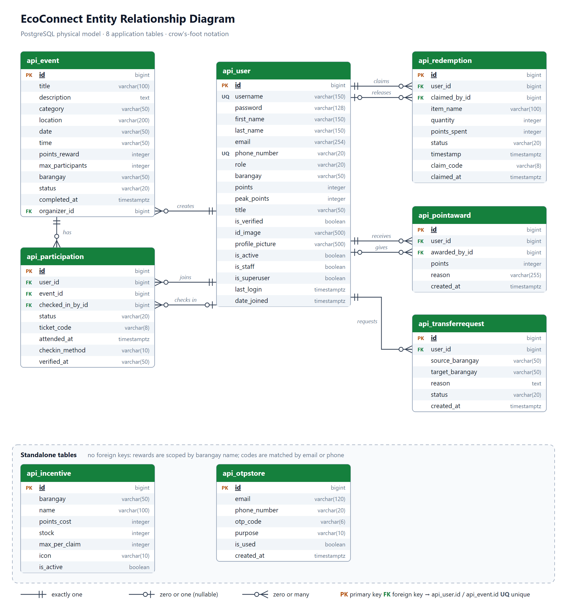
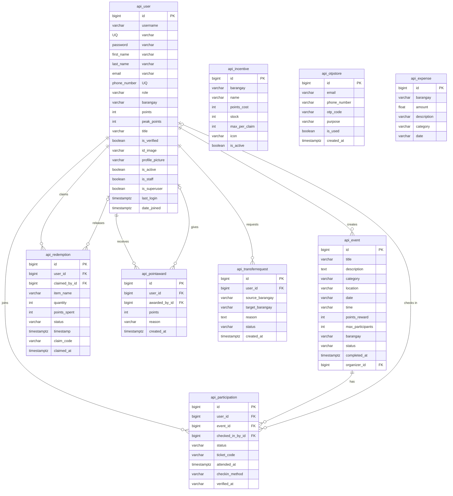

# EcoConnect Entity Relationship Diagram (ERD)

The image above ([ERD.png](ERD.png), vector version [ERD.svg](ERD.svg)) shows the 9 application tables in PostgreSQL with crow's-foot notation. Django's built-in tables (auth groups and permissions, sessions, admin log, content types, migrations) are left out because they belong to the framework, not to EcoConnect's design.

## Relationships

| Foreign key | References | Cardinality | Meaning |
| --- | --- | --- | --- |
| `api_event.organizer_id` | `api_user.id` | one user, many events | An official creates events |
| `api_participation.user_id` | `api_user.id` | one user, many participations | A resident joins events |
| `api_participation.event_id` | `api_event.id` | one event, many participations | An event has participants (each gets a ticket code) |
| `api_participation.checked_in_by_id` | `api_user.id` (nullable) | zero or one official | The official who scanned the ticket |
| `api_redemption.user_id` | `api_user.id` | one user, many claims | A resident reserves rewards |
| `api_redemption.claimed_by_id` | `api_user.id` (nullable) | zero or one official | The official who released the reward by scanning its QR |
| `api_pointaward.user_id` | `api_user.id` | one user, many awards | A resident receives bonus points |
| `api_pointaward.awarded_by_id` | `api_user.id` (nullable) | zero or one official | The official who gave the bonus |
| `api_transferrequest.user_id` | `api_user.id` | one user, many requests | A resident asks to move barangay |

## Design notes

* **Barangay** is stored as a name (`varchar(50)`) on users, events, rewards and expenses. The list of Puerto Princesa barangays is fixed in the app, so it has no table of its own.
* **Redemptions store the item name**, not a link to `api_incentive`, so a past claim stays readable even if the reward is later edited or removed.
* **`api_otpstore`** is matched by email or phone because a sign-up code is issued before the user record exists.
* **`api_expense`** exists in the database but has no screen yet.

## Mermaid source

