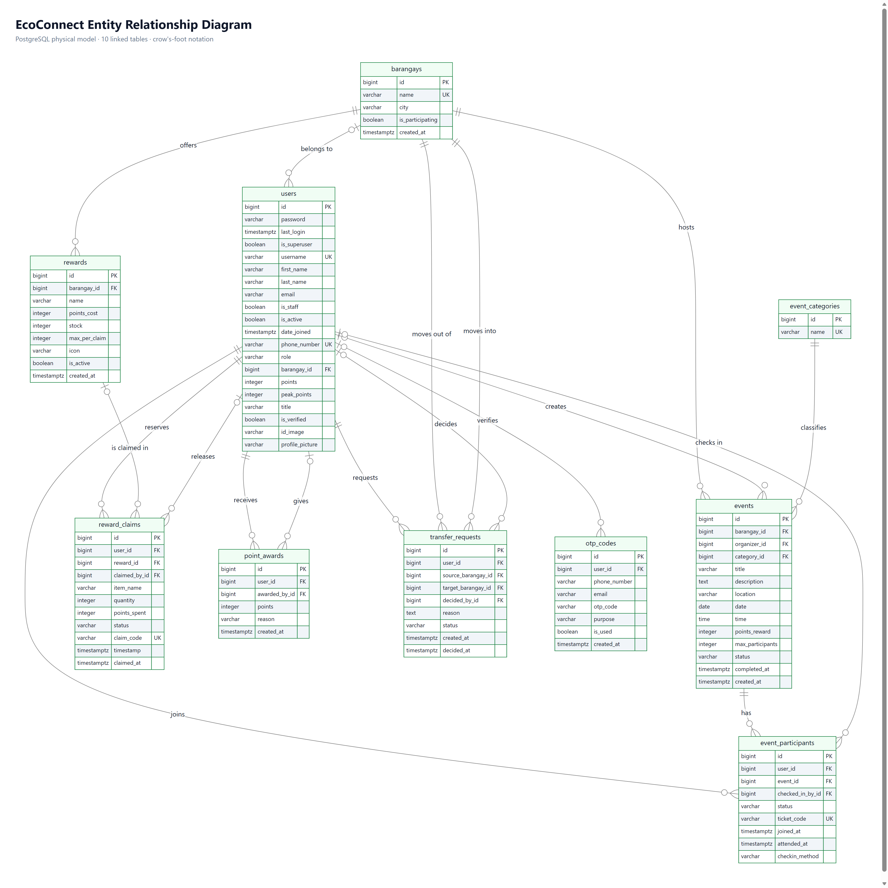
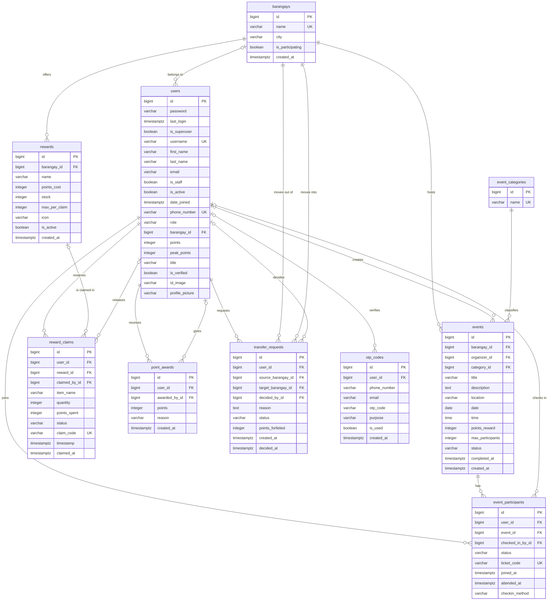

# EcoConnect Entity Relationship Diagram (ERD)

The image above ([ERD.png](ERD.png)) shows the 10 application tables in PostgreSQL with crow's-foot notation. Every table is linked: barangays and event categories are master lists that the other tables point to, so a barangay or category is stored once and referenced everywhere. Django's built-in tables (auth groups and permissions, sessions, admin log, content types, migrations) are left out because they belong to the framework.

## Relationships

| Foreign key | References | Cardinality | Meaning |
| --- | --- | --- | --- |
| `users.barangay_id` | `barangays.id` | many users rows → zero or one barangays row | The user's barangay |
| `events.barangay_id` | `barangays.id` | many events rows → exactly one barangays row | Barangay hosting the event |
| `events.organizer_id` | `users.id` | many events rows → zero or one users row | Official who created it |
| `events.category_id` | `event_categories.id` | many events rows → exactly one event_categories row | Type of event |
| `event_participants.user_id` | `users.id` | many event_participants rows → exactly one users row | Resident who joined |
| `event_participants.event_id` | `events.id` | many event_participants rows → exactly one events row | Event joined |
| `event_participants.checked_in_by_id` | `users.id` | many event_participants rows → zero or one users row | Official who checked them in |
| `rewards.barangay_id` | `barangays.id` | many rewards rows → exactly one barangays row | Barangay offering it |
| `reward_claims.user_id` | `users.id` | many reward_claims rows → exactly one users row | Resident who reserved it |
| `reward_claims.reward_id` | `rewards.id` | many reward_claims rows → zero or one rewards row | Reward reserved |
| `reward_claims.claimed_by_id` | `users.id` | many reward_claims rows → zero or one users row | Official who released it |
| `point_awards.user_id` | `users.id` | many point_awards rows → exactly one users row | Resident who received the points |
| `point_awards.awarded_by_id` | `users.id` | many point_awards rows → zero or one users row | Official who gave them |
| `transfer_requests.user_id` | `users.id` | many transfer_requests rows → exactly one users row | Resident asking to move |
| `transfer_requests.source_barangay_id` | `barangays.id` | many transfer_requests rows → exactly one barangays row | Current barangay |
| `transfer_requests.target_barangay_id` | `barangays.id` | many transfer_requests rows → exactly one barangays row | Barangay they want to move to |
| `transfer_requests.decided_by_id` | `users.id` | many transfer_requests rows → zero or one users row | Official who approved or rejected it |
| `otp_codes.user_id` | `users.id` | many otp_codes rows → zero or one users row | Account the code belongs to (password reset) |

## Design notes

* **Third normal form.** Barangay and event category names are stored once, in `barangays` and `event_categories`, and every other table refers to them by ID.
* **Deleting is guarded.** A barangay or category that is still in use cannot be deleted (`PROTECT`). Deleting a user removes their own records (participations, claims, awards, requests, codes), while records an official only acted on keep their history with the official left empty (`SET_NULL`).
* **Reward claims keep the item name** as well as the link to the reward, so a past claim still reads correctly if the reward is later renamed or removed.
* **One ticket per resident per event** is enforced by a unique constraint on `event_participants (user_id, event_id)`; ticket and pickup codes are unique.
* **`otp_codes.user_id`** is empty for sign-up codes, because the account does not exist yet; reset codes link to the account.

## Mermaid source

